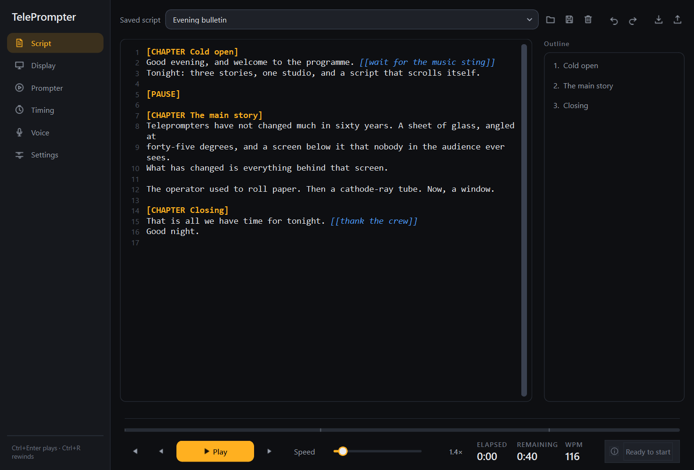
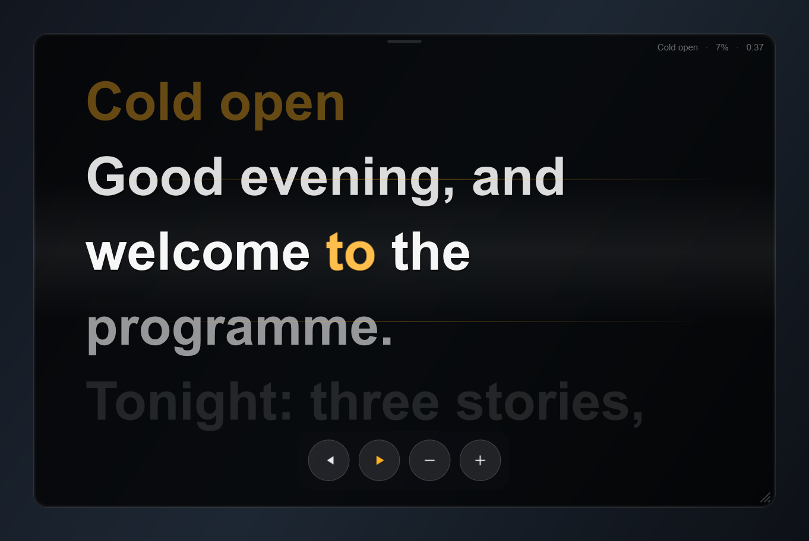
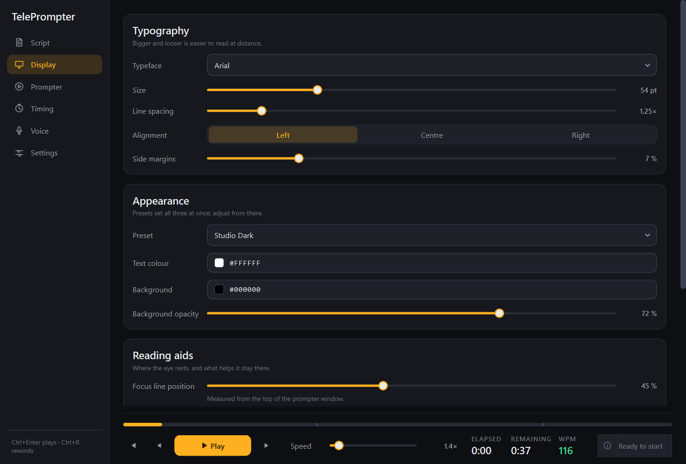
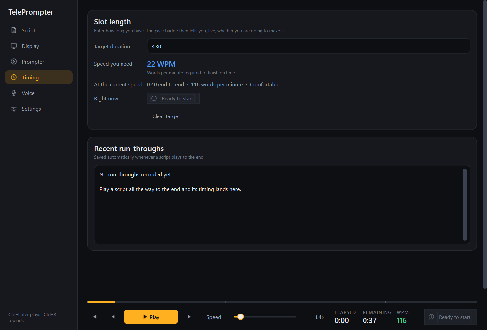
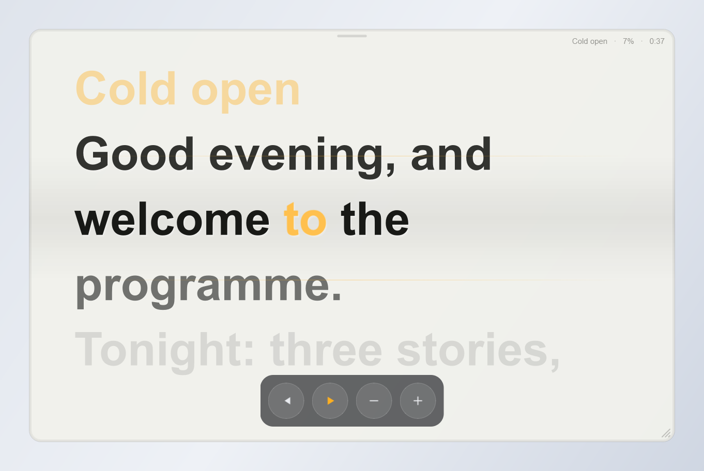
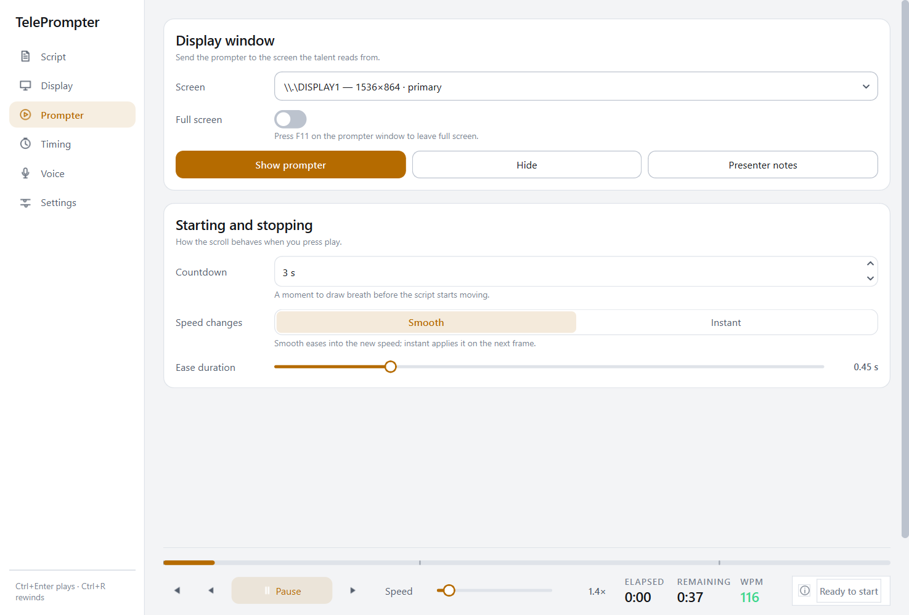

<a id="top"></a>

# TelePrompter

**A studio-grade teleprompter that runs on your own machine.**

[](https://github.com/IACBI/teleprompter/actions/workflows/ci.yml)
[](https://github.com/IACBI/teleprompter/releases/latest)

[](LICENSE)

**Read this in:** [English](#english) · [Türkçe](#turkce)

|  |  |
|---|---|
|  |  |
|  |  |
|  |  |

---

<a id="english"></a>

## English

### Overview

TelePrompter is a teleprompter for reading to a camera. The script appears in a
translucent, always-on-top window that you can send full screen to the monitor
on your rig. The control panel is a separate window that stays out of the way
until you need it.

Scrolling follows elapsed time, not frame count, so the pace is the same on a
60 Hz and a 144 Hz display. TelePrompter knows how long the script should take,
tells you live whether you are ahead, on track or behind, stops at the points you
mark, and keeps `[[notes]]` in a separate presenter notes window instead of on
the glass.

The application has no network code: no account, no telemetry and no update
check. Everything stays on your machine.

### Features

| Area | What you get |
|---|---|
| **Display** | Translucent, always-on-top window · adjustable opacity · send to any connected screen · full screen · horizontal and vertical mirroring for beam-splitter glass |
| **Reading** | Distance fade around a focus band · per-word highlight that sweeps as you read · adjustable focus line · six colour presets, or your own colours |
| **Scrolling** | Real-time pacing · eased speed changes · countdown before playback · optional voice detection that pauses the script when you stop speaking |
| **Script tags** | `[PAUSE]` stops the scroll · `[CHAPTER Title]` starts a chapter · `[[note]]` appears only in the presenter notes window |
| **Navigation** | Chapter outline beside the editor · progress bar with chapter marks, click to seek · previous and next chapter |
| **Timing** | Target duration and the words per minute it requires · live ahead, on track or behind badge · per-chapter rehearsal history |
| **Editor** | Line numbers · tag highlighting · the line being read is marked as it scrolls |
| **Files** | Import `.txt` (up to 25 MB) and `.pdf` (up to 100 MB and 2,000 pages) · export a printable PDF · named script slots · autosave |
| **Interface** | Dark, light or system theme · controls have accessible names for screen readers |
| **Safety** | Atomic saves with one backup copy · rotating log file · a crash dialog that points you to the log |

### Requirements

- Python 3.10 or newer. CI tests 3.10, 3.12 and 3.13 on Windows, macOS and Linux.
- PySide6, installed automatically.

Optional extras add features:

| Extra | Installs | Enables |
|---|---|---|
| `hotkeys` | `keyboard` | Global Space and R shortcuts, from any application |
| `audio` | `sounddevice`, `numpy` | Voice detection |
| `pdf` | `PyMuPDF` | Importing `.pdf` files |
| `all` | all of the above | |

### Installation

**Windows, no Python needed:** download `TelePrompter.exe` from the
[latest release](https://github.com/IACBI/teleprompter/releases/latest). The
release also includes a wheel and a source archive.

From a clone of the repository:

```bash
pip install .            # core
pip install ".[all]"     # with every optional extra
pip install -e ".[dev]"  # development setup
```

The project is not published to PyPI, so install from a clone or from the wheel
attached to a release.

### Usage

```bash
teleprompter
```

`python -m teleprompter` works the same way. Two windows open: the control panel
and the prompter. Type or import a script, press **Play** (or Ctrl+Enter), and
drag the strip along the top of the prompter to position it.

For a camera rig, open the **Prompter** page, choose the screen your prompter
monitor is on, and switch on full screen (F11). If the glass reflects the script,
turn on mirroring under **Display → Reading aids**.

Tag the script as you write it:

```
[CHAPTER Cold open]
Good evening, and welcome to the programme. [[wait for the music sting]]

[PAUSE]

[CHAPTER The main story]
Our first report comes from the north of the country.
```

The full tag reference is in [script tags](docs/script-tags.md), and every
shortcut is listed in [keyboard shortcuts](docs/keyboard.md).

### Configuration

Everything is set in the application; there is no configuration file to edit by
hand. Settings, saved scripts and rehearsal history are stored in `state.json`.
The previous version is kept beside it as `state.json.bak`.

| Platform | `state.json` | Logs |
|---|---|---|
| Windows | `%APPDATA%\TelePrompter\state.json` | `%APPDATA%\TelePrompter\logs` |
| macOS | `~/Library/Application Support/TelePrompter/state.json` | `~/Library/Logs/TelePrompter` |
| Linux | `~/.config/TelePrompter/state.json` | `~/.local/state/TelePrompter/logs` |

On Linux the two base folders follow `XDG_CONFIG_HOME` and `XDG_STATE_HOME` when
they are set. **Settings → Diagnostics** opens both folders.

Two features reach outside the application window, and both are **off until you
turn them on**. Global shortcuts install a system-wide keyboard hook. Voice
detection opens the microphone. Both are explained in
[privacy and system access](docs/privacy.md), including what they do not do.

### Contributing

The engine has no Qt imports, so most changes can be written and tested without
opening a window. Read [architecture](docs/architecture.md) first, then
[CONTRIBUTING.md](CONTRIBUTING.md) for the pull request checklist.

```bash
pip install -e ".[dev]"
ruff check . && ruff format --check .
mypy src/teleprompter/core src/teleprompter/storage
pytest -q
```

Add a test with any behaviour change. A useful bug report includes the script
that triggers it and the log file from **Settings → Diagnostics**. To report a
security issue, use the private route in [SECURITY.md](SECURITY.md) instead of a
public issue.

### License

MIT — see [LICENSE](LICENSE). Author: 𝓐.𝓒.𝓑

[⬆ Back to top](#top)

---

<a id="turkce"></a>

## Türkçe

### Genel Bakış

TelePrompter, kameraya karşı metin okuyanlar için bir masaüstü teleprompter'ı.
Metin saydam ve her zaman üstte duran bir pencerede görünür; bu pencere çekim
düzeneğinizdeki monitöre tam ekran gönderilebilir. Kontrol paneli ayrı bir
pencerede, ihtiyaç duyana kadar kenarda durur.

Kaydırma kare sayısına göre değil geçen süreye göre ilerler; bu yüzden tempo 60 Hz
ve 144 Hz ekranlarda aynıdır. Metninizin ne kadar süreceğini bilir, süreyi
aşıp aşmadığınızı anlık olarak gösterir, işaretlediğiniz yerlerde durur ve
`[[not]]`ları camda değil ayrı bir sunucu notları penceresinde tutar.

Uygulamada ağ kodu yok: hesap, telemetri ve güncelleme denetimi yok. Her şey
sizin bilgisayarınızda kalır.

### Özellikler

| Alan | Neler var |
|---|---|
| **Gösterim** | Saydam, her zaman üstte pencere · ayarlanabilir opaklık · bağlı herhangi bir ekrana gönderme · tam ekran · beam-splitter cam için yatay ve dikey ayna |
| **Okuma** | Odak bandı çevresinde uzaklığa bağlı solma · okudukça ilerleyen kelime vurgusu · ayarlanabilir odak çizgisi · altı renk ön ayarı veya kendi renkleriniz |
| **Kaydırma** | Gerçek zamanlı tempo · yumuşak hız geçişi · oynatmadan önce geri sayım · isteğe bağlı ses algılama: konuşmayı bıraktığınızda metni duraklatır |
| **Script etiketleri** | `[PAUSE]` kaydırmayı durdurur · `[CHAPTER Başlık]` yeni bölüm başlatır · `[[not]]` yalnızca sunucu notları penceresinde görünür |
| **Gezinme** | Editörün yanında bölüm listesi · bölüm işaretli ve tıklanabilir ilerleme çubuğu · önceki ve sonraki bölüm |
| **Zamanlama** | Hedef süre ve bunun için gereken dakikadaki kelime sayısı · anlık önde, hedefte veya geride göstergesi · bölüm bazında prova geçmişi |
| **Editör** | Satır numaraları · etiket renklendirme · okunan satır kaydırma sırasında işaretlenir |
| **Dosyalar** | `.txt` (en fazla 25 MB) ve `.pdf` (en fazla 100 MB ve 2.000 sayfa) içe aktarma · yazdırılabilir PDF dışa aktarma · adlandırılmış script yuvaları · otomatik kayıt |
| **Arayüz** | Koyu, açık veya sistem teması · denetimler ekran okuyucular için adlandırılmış |
| **Güvenlik** | Yedek kopyalı atomik kayıt · döngüsel log dosyası · çökme penceresi sizi log dosyasına yönlendirir |

### Gereksinimler

- Python 3.10 veya üzeri. CI, Windows, macOS ve Linux üzerinde 3.10, 3.12 ve 3.13
  sürümlerini test eder.
- PySide6, otomatik kurulur.

İsteğe bağlı ekstralar ek özellikler açar:

| Ekstra | Kurduğu paketler | Açtığı özellik |
|---|---|---|
| `hotkeys` | `keyboard` | Herhangi bir uygulamadayken de çalışan Space ve R kısayolları |
| `audio` | `sounddevice`, `numpy` | Ses algılama |
| `pdf` | `PyMuPDF` | `.pdf` dosyası içe aktarma |
| `all` | yukarıdakilerin tümü | |

### Kurulum

**Windows, Python gerekmez:** [son sürümden](https://github.com/IACBI/teleprompter/releases/latest)
`TelePrompter.exe` dosyasını indirin. Sürümle birlikte bir wheel ve bir kaynak
arşivi de yayımlanır.

Depoyu klonladıysanız:

```bash
pip install .            # yalnızca çekirdek
pip install ".[all]"     # isteğe bağlı her şey dahil
pip install -e ".[dev]"  # geliştirme ortamı
```

Proje PyPI'da yayımlanmıyor; kurulum için depoyu klonlayın ya da bir sürümdeki
wheel dosyasını kullanın.

### Kullanım

```bash
teleprompter
```

`python -m teleprompter` de aynı şekilde çalışır. Yan yana iki pencere açılır:
kontrol paneli ve prompter. Metninizi yazın ya da içe aktarın, **Play**'e basın
(ya da Ctrl+Enter) ve prompter'ı konumlandırmak için üst kenarındaki şeridi
sürükleyin.

Kamera düzeneğiyle kullanmak için **Prompter** sayfasını açın, prompter
monitörünün bulunduğu ekranı seçin ve tam ekranı (F11) açın. Metin camdan
yansıyorsa **Display → Reading aids** altından aynayı etkinleştirin.

Metni yazarken etiketleyin:

```
[CHAPTER Açılış]
İyi akşamlar, programımıza hoş geldiniz. [[müzik girene kadar bekle]]

[PAUSE]

[CHAPTER Ana haber]
İlk haberimiz ülkenin kuzeyinden geliyor.
```

Etiketlerin tam listesi [script etiketleri](docs/script-tags.md) belgesinde,
kısayolların tamamı ise [klavye kısayolları](docs/keyboard.md) belgesinde.

### Yapılandırma

Her şey uygulama içinden ayarlanır; elle düzenlenecek bir yapılandırma dosyası
yok. Ayarlar, kayıtlı scriptler ve prova geçmişi `state.json` dosyasında tutulur.
Bir önceki sürüm yanında `state.json.bak` olarak saklanır.

| Platform | `state.json` | Loglar |
|---|---|---|
| Windows | `%APPDATA%\TelePrompter\state.json` | `%APPDATA%\TelePrompter\logs` |
| macOS | `~/Library/Application Support/TelePrompter/state.json` | `~/Library/Logs/TelePrompter` |
| Linux | `~/.config/TelePrompter/state.json` | `~/.local/state/TelePrompter/logs` |

Linux'ta bu klasörler `XDG_CONFIG_HOME` ve `XDG_STATE_HOME` tanımlıysa onları
izler. Her iki klasörü de **Settings → Diagnostics** üzerinden açabilirsiniz.

Uygulama penceresinin dışına uzanan iki özellik vardır ve ikisi de **siz
açana kadar kapalıdır**. Global kısayollar sistem geneli bir klavye kancası kurar;
ses algılama mikrofonu açar. İkisinin ne yaptığı ve ne yapmadığı
[gizlilik ve sistem erişimi](docs/privacy.md) belgesinde yazılı.

### Katkı

Motor Qt'ye bağımlı değil; bu yüzden değişikliklerin çoğu pencere açmadan yazılıp
test edilebilir. Önce [mimari](docs/architecture.md) belgesine, sonra pull request
kontrol listesi için [CONTRIBUTING.md](CONTRIBUTING.md) dosyasına bakın.

```bash
pip install -e ".[dev]"
ruff check . && ruff format --check .
mypy src/teleprompter/core src/teleprompter/storage
pytest -q
```

Davranış değiştiren her değişikliğe bir test ekleyin. Hata bildirimlerinde
sorunu tetikleyen script ile **Settings → Diagnostics** üzerinden alınan log
dosyası en çok işe yarayan bilgilerdir. Bir güvenlik açığı bildirmek için herkese
açık bir issue yerine [SECURITY.md](SECURITY.md) dosyasındaki özel yolu kullanın.

### Lisans

MIT — bkz. [LICENSE](LICENSE). Yapımcı: 𝓐.𝓒.𝓑

[⬆ Başa Dön](#top)
